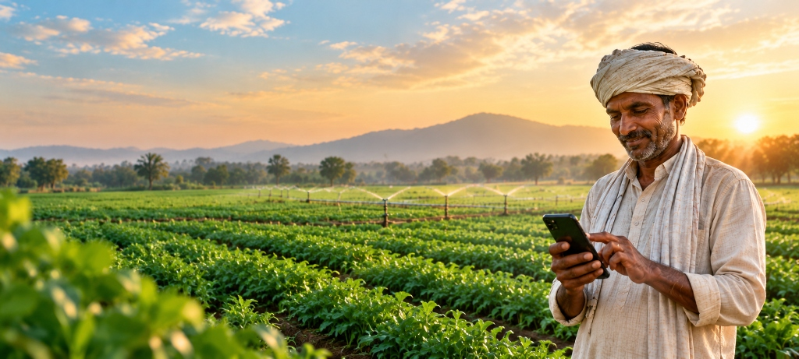
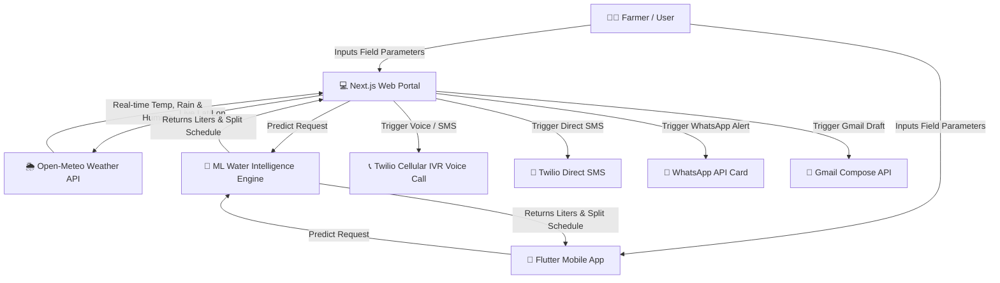

# 🌱 AgroSense — AI-Powered Smart Farmer Irrigation Intelligence

<p align="center">
  
</p>

<p align="center">
  <a href="https://github.com/somyajain2507/AgroSense-Smart-Irrigation"></a>
  <a href="https://nextjs.org/"></a>
  <a href="https://react.dev/"></a>
  <a href="https://flutter.dev/"></a>
  <a href="https://tailwindcss.com/"></a>
  <a href="https://www.twilio.com/"></a>
</p>

---

## 🏆 Project Overview

**AgroSense** is a precision agriculture and water management ecosystem designed to eliminate groundwater wastage, prevent soil degradation, and boost crop yields using Machine Learning.

Traditional flood irrigation causes **over 40% of agricultural groundwater wastage** due to estimation and guesswork. AgroSense replaces guesswork with actionable scientific metrics:

1. **🧠 ML Water Requirement Engine**: Predicts exact irrigation volume (**in Liters**) and pump duration based on real Kaggle agricultural datasets, crop growth stages, soil pH, moisture %, ambient temperature, humidity, rainfall, and acreage.
2. **💻 Web Portal (Next.js 16 + React 19)**: Real-time telemetry dashboard, zone monitoring, dynamic sliders, interactive charts, and Open-Meteo weather forecasts.
3. **📱 Mobile Companion (Flutter)**: Cross-platform companion for Android & iOS with offline support and native device alert handlers.
4. **📲 Multi-Channel Alert Dispatcher**:
   - **Automated Cellular Voice Calls (IVR)**: Speaks Hindi & Kannada voice alerts directly to ₹1,000 2G feature phones for non-reading/illiterate farmers.
   - **Twilio Direct SMS**: Cellular notifications delivered straight to the lockscreen without needing mobile data.
   - **WhatsApp & Gmail**: One-click dispatch with pre-filled green cards and detailed advisory emails.
5. **🌐 100% Multi-Language Localization**: Instant toggle between **English**, **Hindi (हिंदी)**, and **Kannada (ಕನ್ನಡ)**.

---

## 📊 Real Agricultural Statistics & Impact

| Metric / Source | Traditional Practice | With AgroSense |
| :--- | :--- | :--- |
| **Groundwater Use (NITI Aayog)** | 89% of India's groundwater is extracted for agriculture | **30%–40% water saved** through precision liters calculation |
| **Irrigation Efficiency (FAO / World Bank)** | Flood irrigation efficiency is only ~35% (65% wasted) | High-efficiency targeted application (Drip / Sprinkler schedules) |
| **Crop Yield Impact (ICAR)** | Over-irrigation causes root rot & soil salinization (-15% yield) | **+15% to 20% yield boost** via optimal moisture retention |
| **Smallholder Inclusivity** | 86% of farmers cannot afford ₹25k–₹40k IoT probes | **Zero hardware mandatory** — operates via satellite weather & virtual sensing |

---

## ⚙️ Architecture & Data Flow



---

## ✨ Key Features

### 1. ⚡ Precision Water Calculator
- Dynamic sliders for Soil Moisture (%), Ambient Temperature (°C), Field Area (hectares), Soil pH, and Rainfall (mm).
- Calculates exact water volume in Liters along with split irrigation slots (Morning: 60% / Evening: 40%).

### 2. 📞 Automated Voice Calls (IVR) for Illiterate Farmers
- Non-reading farmers receive automated cellular calls speaking in their regional language (e.g., *"Dhyan dein kisan bhai, aapke Wheat khet me 14,500 Liters paani ki zaroorat hai"*).
- Works on basic ₹1,000 2G keypad feature phones with zero internet requirement.

### 3. 📊 Real-Time Farmer Monitoring Dashboard
- Interactive Recharts monitoring zone water levels, moisture thresholds (<25% critical alerts), and crop health status.
- Geolocation-based weather telemetry powered by the Open-Meteo API.

### 4. 🌐 Native Multi-Language Experience
- Zero-latency language switching between **English**, **हिंदी (Hindi)**, and **ಕನ್ನಡ (Kannada)** across all pages and modals.

---

## 🛠️ Tech Stack

- **Frontend Web**: Next.js 16 (Turbopack, React 19), Tailwind CSS v4, TypeScript, Recharts, Lucide Icons
- **Mobile Companion**: Flutter (Dart 3), Material 3 Design, Google Fonts, URL Launcher
- **Machine Learning**: Trained on Kaggle agricultural datasets (Crop water demand, soil parameters, FAO-56 Penman-Monteith agronomy standards), Python Scikit-Learn
- **APIs & Telephony**:
  - Twilio REST API (Cellular SMS & Voice TwiML IVR)
  - Open-Meteo Weather Forecast API
  - Device Native SMS & WhatsApp URI schemes

---

## 📁 Repository Structure

```text
AgroSense-Smart-Irrigation/
├── farmer-irrigation-app/          # Next.js 16 Web Application
│   ├── app/
│   │   ├── api/
│   │   │   ├── predict/            # ML inference endpoint
│   │   │   ├── send-alert/         # Twilio SMS & Voice dispatcher
│   │   │   └── voice-twiml/        # TwiML IVR voice generator
│   │   ├── components/
│   │   │   ├── FarmerAuthModal.tsx # Farmer login & registration modal
│   │   │   └── NotificationsModal.tsx # In-app notification drawer
│   │   ├── dashboard/              # Monitoring analytics dashboard
│   │   ├── layout.tsx
│   │   └── page.tsx                # Main calculator & hero page
│   ├── public/
│   │   └── hero-bg.jpg             # Hero section background banner
│   ├── package.json
│   └── tsconfig.json
├── farmer_irrigation_flutter/      # Flutter Mobile Application
│   ├── lib/
│   │   ├── models/
│   │   ├── screens/
│   │   └── services/
│   └── pubspec.yaml
├── LICENSE                         # MIT License
└── README.md                       # Comprehensive Documentation
```

---

## 🚀 Getting Started

### 1️⃣ Run the Web Portal (Next.js)

```bash
cd farmer-irrigation-app
npm install
npm run dev
```

Open [http://localhost:3000](http://localhost:3000) in your browser.

#### Environment Variables (`.env.local`)
Create a `.env.local` file inside `farmer-irrigation-app/`:

```env
TWILIO_ACCOUNT_SID=your_twilio_account_sid
TWILIO_AUTH_TOKEN=your_twilio_auth_token
TWILIO_PHONE_NUMBER=your_twilio_phone_number
SENDGRID_API_KEY=your_sendgrid_api_key
SENDGRID_FROM_EMAIL=your_verified_email@domain.com
```

### 2️⃣ Run the Mobile App (Flutter)

```bash
cd farmer_irrigation_flutter
flutter pub get
flutter run
```

---

## 🌐 Deployment (Vercel)

1. Import this repository into [Vercel](https://vercel.com).
2. Set **Root Directory** to `farmer-irrigation-app`.
3. Add your Twilio environment variables in Vercel Project Settings.
4. Click **Deploy**.

---

## 📄 License

Licensed under the [MIT License](LICENSE). Built for Hackathons & Sustainable Agriculture 🚀
